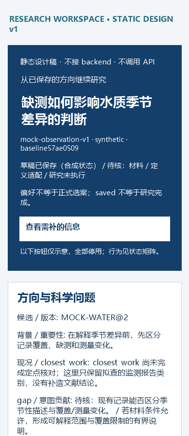

# Stage 3 HTML / UX 设计稿

交付版本：`stage3-html-ux-design-20261029-v1`。固定基线：`57ae0509d7ccf17c92080434d8454b4e2352c33c`。

这是设计稿和静态布局示例，**不接 backend、不调用 API**。所有案例均为明确合成的布局数据；没有真人选案、真实材料取得、研究结果或执行授权。文档分支不改变 shipping source，也不开 source PR。

## 阅读入口

1. [设计说明与完整流程](DESIGN.md)：信息架构、七类内容、状态与边界。
2. [离线设计文档](design.html)：下载整个目录后在本地打开；含两个案例和设计表。
3. [状态／互动矩阵](STATES.md)：19种状态；[JSON原件](state-matrix.json)。
4. [来源→元素映射](SOURCE_MAP.md)：36条对照；[JSON原件](source-map.json)。
5. [一次 self-review](SELF_REVIEW.md)：8项 finding、修正与剩余限制；[JSON原件](self-review.json)。

[下载完整离线设计包](downloads/design-only.zip)，解压后打开 `design.html`。包只含设计文档、合成 fixture 和静态产物，不包含产品源码、真实材料或可执行研究。

| 案例 | Stage 2 保存入口（静态） | Stage 3 静态页面 | 桌机／手机 wireframe |
|---|---|---|---|
| 观察研究 | [简中](stage2-observation.zh-CN.html) · [繁中](stage2-observation.zh-TW.html) · [EN](stage2-observation.en.html) | [简中](mock-observation.zh-CN.html) · [繁中](mock-observation.zh-TW.html) · [EN](mock-observation.en.html) | [1440px](wireframes/observation.zh-CN.1440.full.png) · [390px](wireframes/observation.zh-CN.390.full.png) |
| 理论／形式研究 | [简中](stage2-theory.zh-CN.html) · [繁中](stage2-theory.zh-TW.html) · [EN](stage2-theory.en.html) | [简中](mock-theory.zh-CN.html) · [繁中](mock-theory.zh-TW.html) · [EN](mock-theory.en.html) | [1440px](wireframes/theory.zh-CN.1440.full.png) · [390px](wireframes/theory.zh-CN.390.full.png) |

`mock-*.html` 是三语言静态页面；`wireframes/` 是1440px／390px绘制的静态 wireframe。它们不是浏览器截图，也不是运行中的产品。布局图由与表／卡相同的合成 saved-view 文件生成。

## 两种研究型态

- 观察研究：缺测记录如何影响对河道水质季节差异的判断。完整走查偏好、保存草稿、逐题方案、unknown 与续接。
- 理论／形式研究：有限图上两类路径约束的相容性。用同一版面呈现定义、证明义务、反例与共享设计，不强制数据集、RCT、p-value 或 GPU。

原科学文字在语言切换时保持原值；英文／繁中／简中切换的是界面标签。合成内容不会变成可提交的规划包；fixture 没有真实外部 pins，未做产品 schema/admission 验证。

## 验证范围

只做文档结构、引用一致性、无联网入口与静态绘图检查，以及一次设计自查。真人 usability、浏览器交互、辅助技术、200%缩放实际验证、部署/E2E、NativePlanner、模型评审、研究实验、科学有效性均为 `NOT_RUN`。CI、已接受 H03/H05 和旧 HTTP 案例不重跑。

F01/F02 缺少结构化来源的部分保持 future／待补。F03 私人候选原件未取得；本稿只规定图位、阅读互动和引用约束，不接入或重写图引擎。无明确引用的条件式草稿保留逐题表和缺件提示，不从自由文字猜 DAG。

设计与 ACK 不增加为 #420 merge 或实际 E2E 的 gate。核心组继续负责 HTML/JS/CSS 实现、Host/assets/registry、部署、实际 E2E 与 canonical writer。
