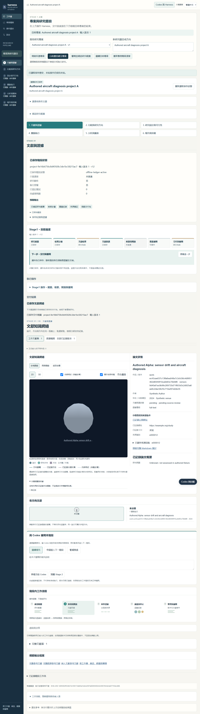
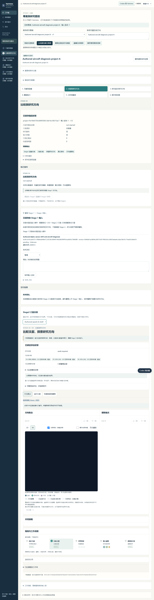

# #295 teammate Wiki and CI repair batches, 2026-10-14

The launch guide directed teammates to merged main or to source HTML templates.
Those templates require generated data and a local server; installing Python
alone also does not install the pinned Wiki dependencies. The new PowerShell
quick start downloads this PR branch, installs requirements into a copy venv,
generates the repository example and starts ProjectHost with exact source/view
hashes. It opens the original main six-stage Wiki with the v6 layout retained.

## Batch 1: terminal Wiki entry

Use [the complete commands](../../references/research-workspace/PORTABLE_ATLAS_SETUP.md#terminal-quick-start-for-pr-295).
Keep the terminal running and use its printed URL on the same computer.
With views registered, `/` redirects to the first saved Atlas. Expand Historical
reference to read the saved example; current-project output stays separate.
The Stage2 reference is on the same server. A new project correctly displays
Not generated yet until its own validated delivery exists. Nothing enables a
model, search, budget or native session by opening the Wiki.

## Batch 2: exact-current CI defects

Baseline [run38448280279](https://github.com/WenyuChiou/AutoResearchAgent/actions/runs/38448280279)
failed on all three OS jobs, not cancelled. Ubuntu/macOS each had one error;
Windows had one failure and three errors. All3249 IDs were counted and no
partition was incomplete. Step13 PR contracts was blocked by step12 failure;
the governance-only step was a normal conditional skip under full scope.

- Test jobs now suppress bytecode writes from the parent, spawn workers and
  nested Python. The real runtime guard still detects added or changed pyc.
- The Windows busy-cleanup spy wraps only process_channel's subprocess facade;
  real taskkill cleanup is retained and is not miscounted as an owned child.
- Two deadline-sensitive modules join the existing supervised serial phase.
  Every planned/run ID, failure, platform and original timeout remains required.

The precise Ubuntu identity field difference and old Windows timeout cause are
not fully proven by the retained logs. These bounded corrections and local
passes require new-head hosted CI; they are not claims that all platforms pass.

## Actual verification

- CI-related checks:47 ran,46 passed,1 original symlink-permission skip,
  zero failures/errors,360.574 seconds. The reported failed selectors, sealed
  observations, Git checkout and new-pyc refusal all ran without skipping.
- Installed Chrome:1 Python test,13 browser groups passed in167.305 seconds.
  Project/result identity, stage switching, Stage2 examples, long content,
  all three languages and widths1600/1024/390 were exercised. Actual2D/3D
  canvas pixels were checked. There were0POSTs,0external requests,0page errors,
  and the fixture's SQLite/ledger remained unchanged after cleanup.
- Separately started the documented real CLI server from a fresh physical
  copy environment with50 pinned packages. Manual browser use read the Stage1
  example, synchronized a paper/detail click, created an isolated test project
  without research, and confirmed Stage1/2 show Not generated yet and deny
  execution until their existing intake/runtime gates are satisfied.
- Ruff0.15.13, codespell2.4.3 and diffcheck pass for the affected increment.
- [Initial independent review](INDEPENDENT-REVIEW.md) and
  [final R2 binding](INDEPENDENT-REVIEW-R2.md) found no scoped blocking issue.
  They are static implementation reviews, not Core approval.

See [the manifest](manifest.json) for exact source, patch, log and image hashes.
The browser driver receipt/inventory and original failure logs remain private;
only hashes and authored screenshots are published. No copyrighted paper,
account receipt, credential, permit or private A03 package is included.

The renderer, runtime pin checks, frozen v1, Unknowns, budgets and original
failures are unchanged. This preserves a working engineering interface; it does
not prove a complete live Stage1/Stage2 research run or scientific improvement.
No new PR, approve, resolve or merge is part of this handoff.
