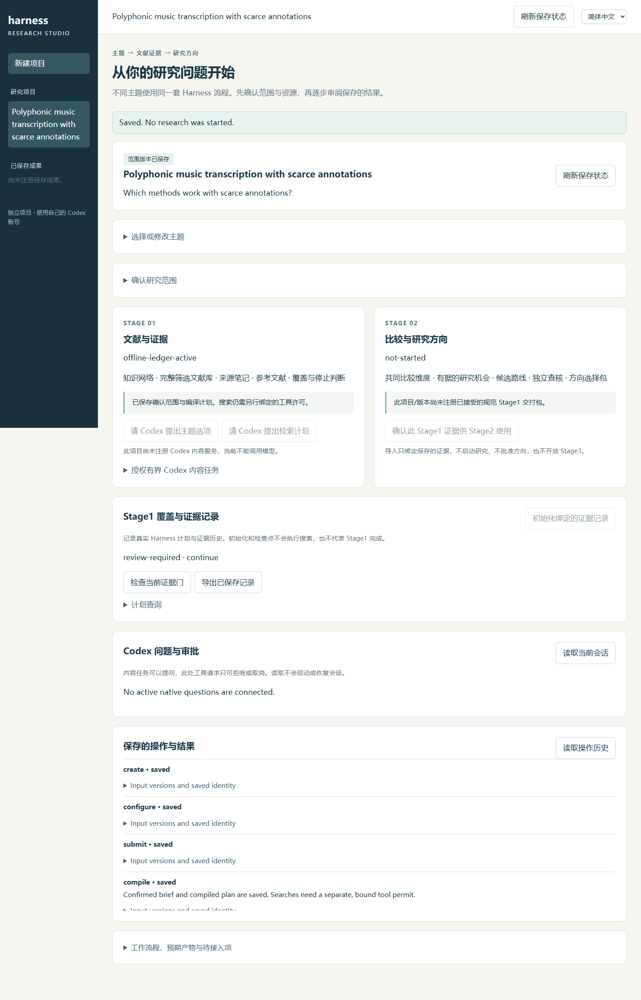
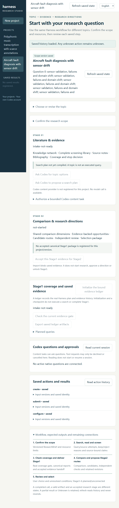

# Universal project interface: reviewable current increment

This pack exposes actual screenshots and raw receipts for the new arbitrary-topic
portal without publishing private source packages, project databases or credentials.
It supplements issue #211; it is **not** complete three-candidate acceptance.

## Source and result

The installed Chrome155 run passed **16/16**, exit0, on `e3b0bf5` / tree
`a59006ea5738c70bda153f1298b23b133f805686`. Final Stage candidate #271
`460175528fab1e52f42298bf183daa22c3e2ff85` has the identical tree: its final
normal dependency merge changes ancestry only. Reuse is exact-tree evidence.
The separate later Native candidate's JS/provider changes require their own tests;
this browser receipt does not validate those changed bytes.

The cases use independent synthetic music/aircraft topics and actual offline
HTTP, SQLite, ResearchBrief/compiler, CoverageLedger, checkpoint and export.
The search-plan and queued/terminal model replies are explicit fixture responses.
No model, native research, external search or scientific assessment was run.
The receipt retains expected HTTP rejection/response-loss diagnostics.

## Actual screenshots

Viewport/action/source inventory are recorded in the [raw browser receipt](raw/project-browser-heade3b0bf5-0b00cef7-af98-4224-a25b-e343b5a482b4.json).
Its environment is Chrome155.0.8059.39, Python3.11.9, Node24.19.0.

## Preserved failed check

The [original focused log](raw/universal-projects-focused-v1.log) is **FAILED**:
68 tests /60.467s /one import error. All67 loaded tests passed, but the
[original runner](raw/universal-projects-focused-v1.py) names a nonexistent
`test_stage1_formal_intake` module. The raw log fixes neither head nor process exit.
It must not be relabelled as a final-candidate PASS. The real formal-target tests
passed separately; those are distinct evidence, not a combined76-test result.

Each raw file's bytes and SHA256 are listed in [manifest.json](manifest.json).
`.gitattributes` disables text conversion for raw receipts and preserves their
original CRCRLF and the old runner's trailing blank at EOF. Whitespace exclusions
are limited to this immutable raw-evidence folder; production checks are unchanged.
Original CRLF/CRCRLF
is retained rather than rewriting logs. Paths and temporary loopback metadata in
the raw receipt are test environment metadata, not authentication evidence.

## Remaining boundary

Stage1 query execution and ledger-to-canonical delivery remain unconnected.
Stage2 trusted package import/initialization is not generation, extraction,
R1/R2/ADJ or route acceptance. Stage3–6 are planned/unconnected. CI, static
hash checks, these screenshots and synthetic process evidence do not prove
account authentication, native research completion or scientific improvement.

## Native broker and portable entry: exact current source

The [final focused raw log](raw/native-projects-final-v4.log) passed **47 tests /
35.214s /0skip**, observed process exit0. The [actual runner](raw/native-projects-final-v1.py)
loads model24 +factory9 +launcher9 +capability-map5. The manifest binds all nine
working source paths/hashes at checkout `c139a5fa`; these bytes are committed
unchanged into the final Native candidate. The result is source-file evidence,
not a claim that the final public commit itself was run locally.

The [Unicode red reproduction](raw/native-unicode-before-fix-v7.log) is retained:
one actual JS/server hash comparison FAILED. [The corrected focused run](raw/focused-native-unicode-final-v7.log)
passed24; keys now sort by Unicode codepoint on both sides. The [raw fix receipt](raw/project-native-unicode-hash-receipt-v7.json)
retains source and result hashes. [The earlier47-test PASS](raw/native-projects-final-v3.log)
is pre-Unicode historical evidence, not current-JS evidence.

The final tests include exact identity drift, response loss with zero additional
provider writes, genuine SQLite reopen/new owner, conservative execution-unknown,
actual temporary HTTP refusal/GET recovery, full Unicode hash binding, own-account
factory guards and a copied-checkout portable prepare path. They use fake channels
or providers. They prove neither actual account login nor native/model execution,
production process containment, complete Stage1/2 research or scientific improvement.
The Stage browser screenshots above do not validate the later Native JS changes.
