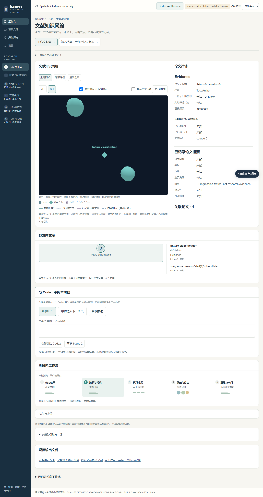
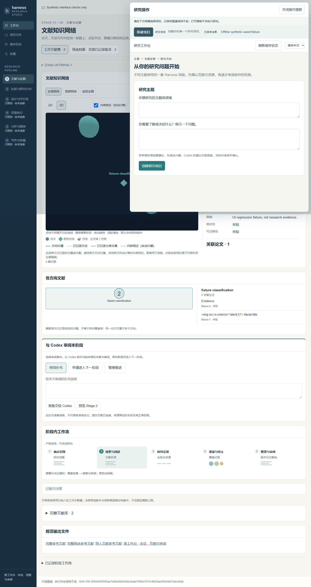

# Preserve the reviewed v6 UI

The project service replaced its entry with the operation portal and could omit the private saved-view registration. This change keeps registered v6 pages as the main view and adds a lazy same-origin operation drawer. Original Atlas package, graph, detail, compact summary and process-fold bytes are unchanged. Root redirects preserve relative asset paths. A fresh project without a saved package still uses explicit intake and never receives invented graph data.

- Focused real HTTP/SQLite: 14 tests PASS, 11.512 seconds (3 overlay + 11 existing project-host tests).
- Capability registry: 5 tests PASS; frozen v1 unchanged.
- Installed Chrome, synthetic repository saved fixture, real HTTP/SQLite: 4 browser checks PASS, 0 POST, 0 page errors, empty fixture stderr and exit 0. Main/drawer screenshots below are fixture data, not research results.
- Separately, the existing private r27 Stage1 saved view ran the same four browser checks, with no model/search/native call or package rewrite. That private case and its contents are not published here.
- Existing source-window/channel VM checks PASS (4 GET requests, 0 mutation): source/origin/credential, refresh, stale and late-response boundaries. This is an authored channel test, not live iframe-native acceptance.
- Initial lint found one unused test import; repaired. An initial discovery accidentally also ran 5 imported Atlas-host tests (all passed); the focused receipt lists the intended 14-test scope after importing the fixture module instead.

Opening/closing, language changes and history refresh do not dispatch research. Only `/projects-panel.html` permits same-origin framing; parent Atlas and standalone project operations remain non-embeddable. Same-origin iframe styles are separate but this is not a script-security sandbox. Project selection is explicit: a historical saved case does not become the active project or an execution permit. No Stage1/Stage2 completion, native research acceptance, new model/search authority or scientific improvement is claimed. Stage2 execution remains deferred and Stage3-6 planned/unconnected.

Reproduce with `tests/browser/project-operations-test.cjs` using absolute `--repo`, `--python`, `--temp-root`, `--output`, `--playwright`, `--chrome` arguments. Without view arguments it creates only the existing synthetic repository fixture. Optional private `--views-config` and `--views-sha256` reuse a pinned saved view without rebuilding or executing research. The browser receipt contains the candidate source/served hashes; private screenshot paths were replaced by the adjacent public filenames only.

Public test text normalizes Windows line endings only. Immutable private raw captures retain their original bytes; their hashes are listed separately in manifest.json. An initial staged diff check refused doubled-CR capture text; no tests were rerun or results replaced to repair that presentation.
